<p align="center">
  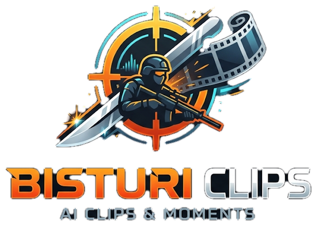
</p>

<h3 align="center">Sua live de CS2 vira cortes, shorts e montagem. Sozinho.</h3>

<p align="center">
  <a href="#instalar">Instalar</a> ·
  <a href="#primeiro-uso">Primeiro uso</a> ·
  <a href="#de-onde-vem-o-vídeo-os-quatro-caminhos">Os caminhos</a> ·
  <a href="#perguntas-frequentes">Perguntas</a> ·
  <a href="#como-relatar-um-problema">Relatar problema</a>
</p>

---

## O que é

O **Bisturi Clips** é um programa para Windows. Você entrega o vídeo da sua partida de CS2. Ele assiste ao vídeo inteiro, acha as suas jogadas e as suas reações e devolve tudo editado.

O que ele faz:

- **Lê o kill feed** e acha cada abate seu.
- **Junta o round num vídeo só** e corta o tempo parado entre os abates.
- **Ouve a sua voz** e marca raiva, hype e risada.
- **Dá uma nota de 0 a 99** para cada momento e escolhe os melhores.
- **Monta shorts verticais**, com o selo da jogada (TRIPLE KILL, QUADRA KILL, ACE) e a sua webcam em cima, quando ela aparece no vídeo.
- **Monta um vídeo com as melhores jogadas**, com música livre e o primeiro tiro no ponto alto da música.
- **Separa os FAILS** numa compilação própria.
- **Escreve título, descrição e hashtags** de cada short. É só copiar e postar.

O programa é grátis, tem o código aberto e não pede conta nem cadastro.

<p align="center">
  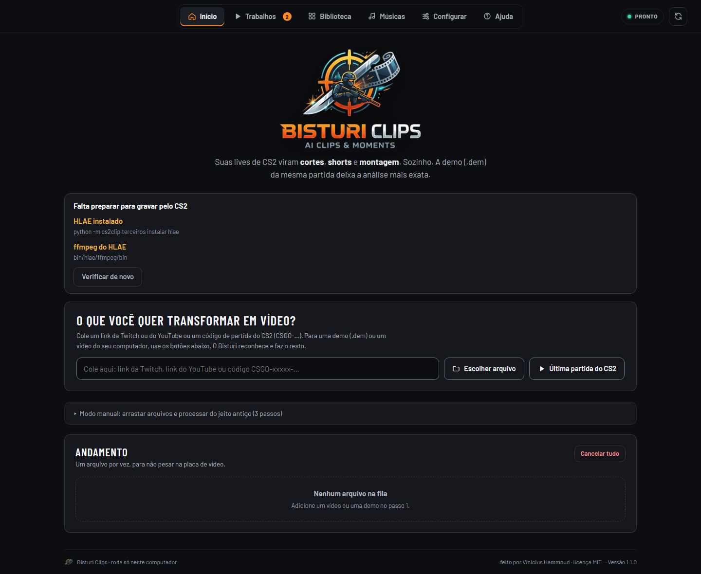<br>
  <em>A tela Início. O cartão de cima só interessa a quem vai gravar pela demo (parte avançada).</em>
</p>

<p align="center">
  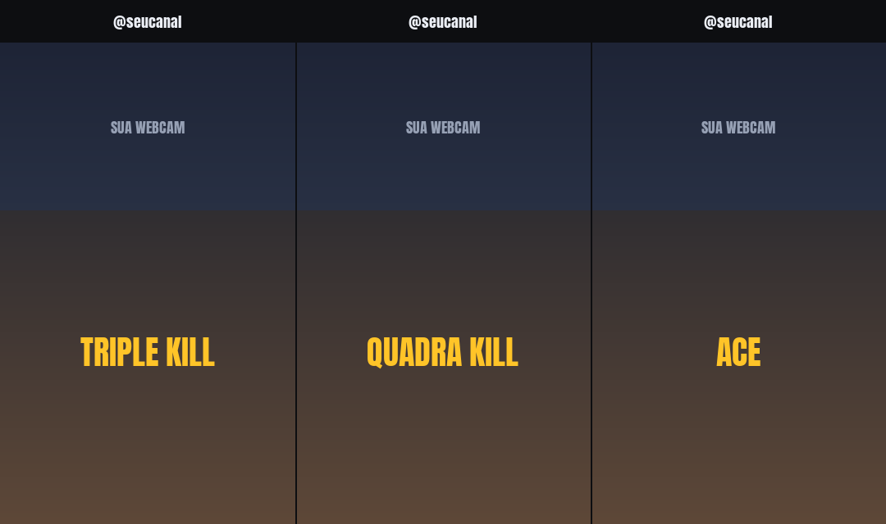<br>
  <em>Desenho de exemplo do formato do short. Não é um vídeo de verdade.</em>
</p>

## Para quem é

Para quem joga CS2, faz live ou grava as partidas e quer postar os melhores momentos sem editar na mão. Você não precisa saber programar nem editar vídeo.

Antes de baixar, saiba os limites:

- Só funciona no Windows.
- O vídeo precisa mostrar o **kill feed** (a lista de abates no canto da tela).
- O jogo precisa estar em português, inglês ou espanhol.
- As reações pela voz (raiva, hype, risada) só funcionam em português.
- A gravação pela demo é experimental (veja a parte [avançada](#avançado-gravar-pela-demo-e-baixar-por-código)).

## O que você precisa

| | |
|---|---|
| **Sistema** | Windows 10 (versão 1809 ou mais nova) ou Windows 11, de 64 bits. |
| **Placa de vídeo** | NVIDIA recomendada. Sem ela o programa funciona, mas a parte de entender a voz fica mais lenta e usa um modelo de voz menor. |
| **Espaço livre** | Cerca de 4 GB para o programa com placa NVIDIA, ou cerca de 2 GB sem. Some o espaço dos seus vídeos: cada vídeo processado gera vários GB. |
| **Internet** | Só para instalar e para baixar um VOD ou uma demo. Depois disso o programa trabalha sem internet. |
| **Vídeo** | Gravação ou VOD da partida com o kill feed visível. Webcam é opcional. |

Os números de espaço e de download deste arquivo são aproximados. São valores medidos na fase de testes; podem variar.

## Instalar

1. Abra a aba **Releases**, na lateral direita desta página, e escolha a versão mais nova.
2. Baixe o arquivo **`BisturiClips-Setup-1.1.0.exe`**.
3. Dê dois cliques nele. Se aparecer a tela azul "O Windows protegeu o computador", veja [o aviso do Windows](#o-windows-protegeu-o-computador) logo abaixo.
4. Siga o assistente. Ele pergunta quatro coisas:
   - **A pasta do programa.** Pode deixar a sugerida.
   - **A pasta de dados.** É onde ficam os seus vídeos, os kits prontos, a configuração e o modelo de voz. A sugerida é `Vídeos\Bisturi Clips`. Ela fica separada do programa: atualizar ou desinstalar não apaga nada dela, a menos que você peça.
   - **As tarefas:** "Criar um atalho na Área de Trabalho", "Baixar as músicas livres para as montagens (CC0, cerca de 170 MB)", "Baixar agora o modelo de voz (1,6 GB com placa NVIDIA; 0,5 GB sem)" e "Gravar pela demo: instalar o HLAE e o boiler (cerca de 130 MB no disco, cerca de 10 MB de download)". As três primeiras vêm marcadas. A última vem desmarcada e só serve para a parte avançada.
   - **A placa de vídeo.** O instalador procura uma placa NVIDIA. Se achar, a opção "Usar a placa de vídeo NVIDIA" vem marcada.
5. Espere terminar. O assistente mostra o andamento em quatro etapas. Leva alguns minutos e depende da sua internet.
6. Abra o **Bisturi Clips** pelo atalho.

**O que o instalador faz**

- Instala só para o seu usuário. Não pede permissão de administrador.
- Traz o Python do próprio programa. Não mexe em nenhum Python que você já tenha.
- Baixa o FFmpeg (o programa que lê e grava vídeo) direto de quem o distribui.
- Confere a "impressão digital" (hash) do FFmpeg, dos pacotes, das músicas e do modelo de voz. Arquivo que não confere não entra.
- Se algo falhar no meio, ele avisa "A instalação não terminou". Abra o instalador de novo: ele continua de onde parou e não apaga os seus dados. O que aconteceu fica no arquivo `instalacao.log`, na pasta do programa.

**Quanto baixa e quanto ocupa**

| | Com placa NVIDIA | Sem placa NVIDIA |
|---|---|---|
| Download | cerca de 3 GB | cerca de 1,1 GB |
| Espaço no disco | cerca de 4 GB | cerca de 2 GB |
| Modelo de voz | 1,6 GB | 0,5 GB |
| Parte que usa a placa | cerca de 0,8 GB | não é baixada |
| Músicas livres (opcional) | cerca de 170 MB | cerca de 170 MB |
| Gravar pela demo (opcional) | cerca de 130 MB (cerca de 10 MB de download) | cerca de 130 MB (cerca de 10 MB de download) |

### "O Windows protegeu o computador"

Na primeira vez o Windows pode mostrar uma tela azul com esse título. É o SmartScreen, a proteção do Windows.

Clique em **Mais informações** e depois em **Executar assim mesmo**.

Isso acontece porque o instalador ainda não tem assinatura digital. O Windows mostra esse aviso para todo programa sem assinatura e ainda pouco conhecido.

Para ter certeza de que o arquivo é o verdadeiro, confira a impressão digital dele:

1. Baixe também o arquivo `SHA256SUMS.txt` da mesma Release.
2. Abra o PowerShell na pasta do download e rode:
   ```powershell
   Get-FileHash .\BisturiClips-Setup-1.1.0.exe -Algorithm SHA256
   ```
3. Compare o resultado com a linha do `SHA256SUMS.txt`. Tem de ser igual, letra por letra. Se for diferente, não instale.

## Primeiro uso

**1. Abra o programa** pelo atalho. Ele abre numa janela própria, sem tela preta de comandos. A janela usa o Microsoft Edge, que já vem no Windows. Se o Edge não estiver no PC, o programa abre no seu navegador.

**2. Diga o @ do seu canal**, se quiser. Ele vai nas hashtags e aparece pequeno no topo dos shorts quando a webcam é detectada. Pode deixar vazio ou clicar em **Pular**. Dá para mudar depois em **Configurar**.

<p align="center">
  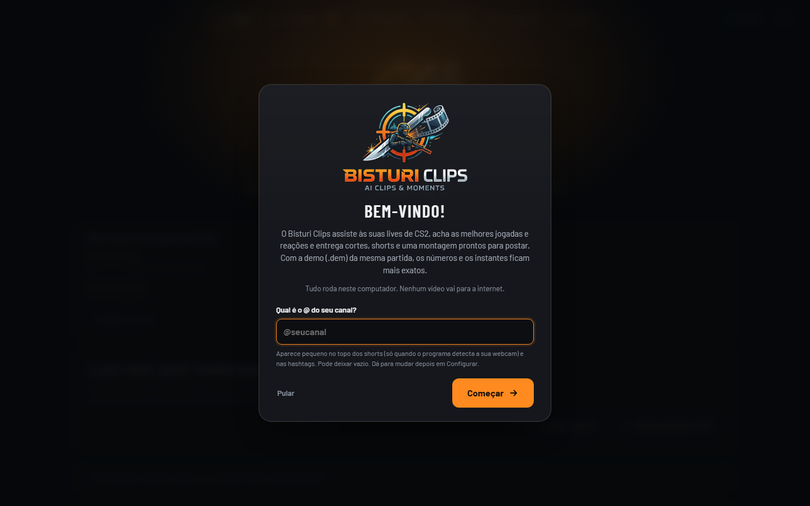<br>
  <em>A janela de boas-vindas aparece só na primeira vez.</em>
</p>

**3. Baixe o modelo de voz, se faltar.** Quando o modelo não veio na instalação, a Início mostra o cartão "Falta baixar o modelo de voz". Clique em **Baixar agora**. Se a internet cair ou você cancelar, ele continua de onde parou.

<p align="center">
  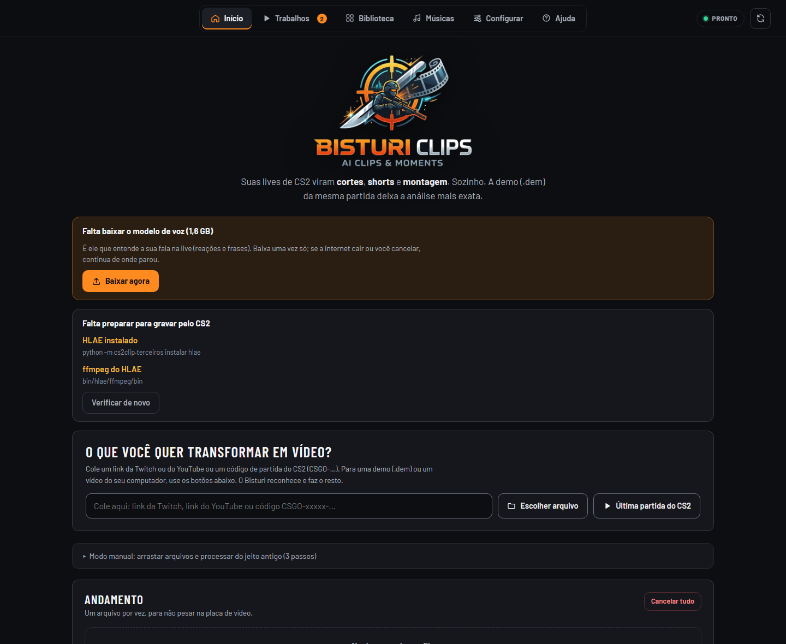<br>
  <em>O cartão do modelo de voz só aparece quando o modelo falta.</em>
</p>

**4. Entregue o vídeo.** Na caixa "O que você quer transformar em vídeo?", cole um link ou clique em **Escolher arquivo**. O Bisturi reconhece o que é, mostra o plano com as etapas e o tempo estimado, e você clica em **Começar**.

**5. Acompanhe em Trabalhos.** Cada trabalho mostra as etapas e avisa quando precisa de você. Dá para **Cancelar** e depois **Retomar**. A primeira análise de uma live longa demora, mais ainda sem placa NVIDIA.

<p align="center">
  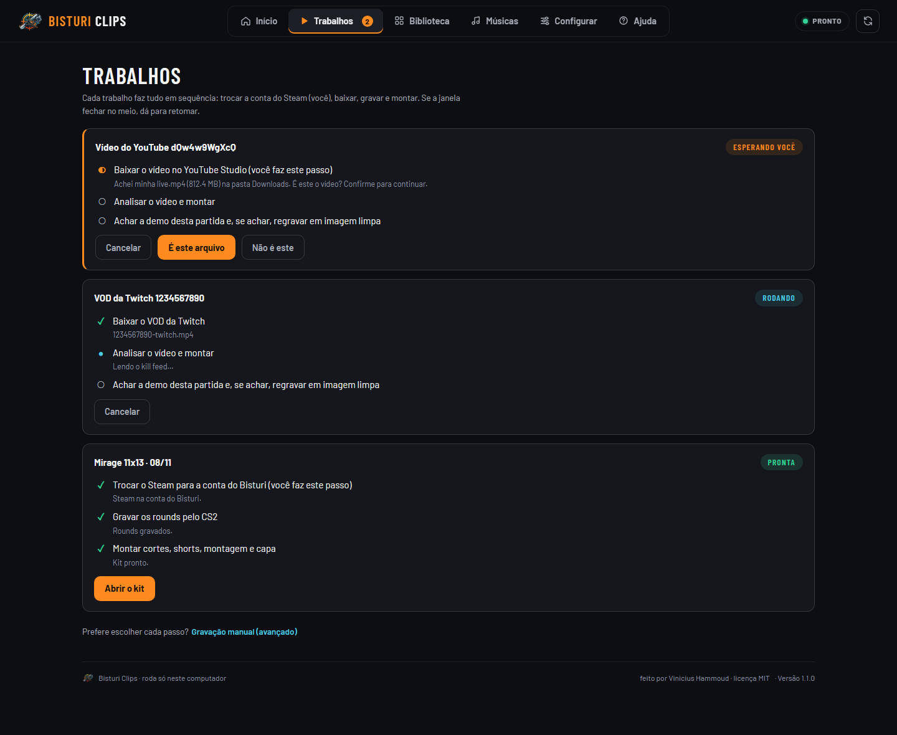<br>
  <em>A tela Trabalhos, com dados de exemplo: um trabalho esperando você, um rodando e um pronto.</em>
</p>

**6. Veja, revise e poste.** Os resultados ficam na **Biblioteca**. Abra um vídeo para ver o resultado.

<p align="center">
  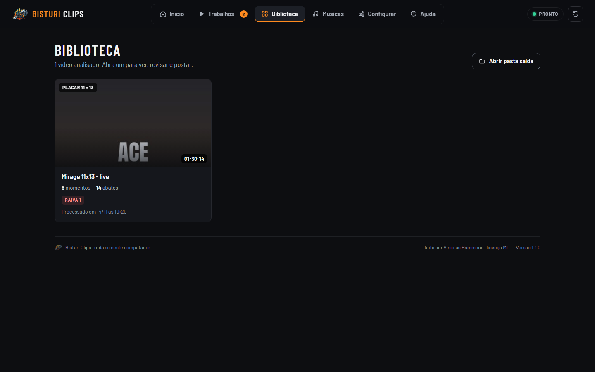<br>
  <em>A Biblioteca, com um vídeo de exemplo.</em>
</p>

Na tela do resultado você encontra:

- **Pronto para postar:** os melhores shorts, com os botões **Título** e **Descrição** para copiar.
- **Ver montagem**, **Copiar capítulos** (para a descrição do YouTube), **Relatório** e **Abrir pasta**.
- **Trocar a música:** solta a música só daquele vídeo. Na próxima vez que a montagem for gerada, sai outra.
- **Gerar de novo** e **Apagar kit**. Apagar o kit não apaga o vídeo original.
- **Momentos:** todas as jogadas e reações. Marque **Gostei** ou **Descartar** e veja "Por que esta nota?".

<p align="center">
  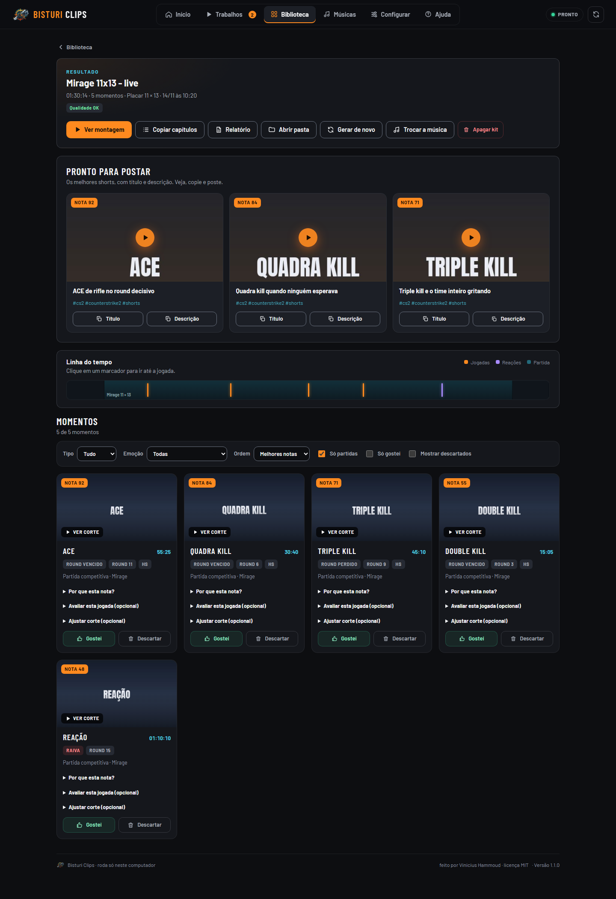<br>
  <em>O resultado de um vídeo de exemplo.</em>
</p>

**7. Para sair, feche a janela.** O programa encerra em alguns segundos. Se houver um processamento rodando, ele termina o trabalho antes de sair. Para encerrar na hora, use **Ajuda** e o botão **Encerrar o programa agora**.

**Três coisas que ajudam a entender o resultado**

- **Só round com 3 ou mais abates seus vira short e montagem.** Round com 1 ou 2 abates continua virando corte. Se a partida não tiver nenhum round assim, o programa avisa "Nada para postar". O número muda em Configurar, em "Abates mínimos no round (montagem e short)".
- **O programa não atrapalha o seu jogo.** Com o CS2 ou o OBS abertos, ele faz só uma prévia leve. Feche o jogo e processe de novo para gerar os cortes.
- **As opções ficam em Configurar.** As mudanças valem na próxima vez que você processar.

<p align="center">
  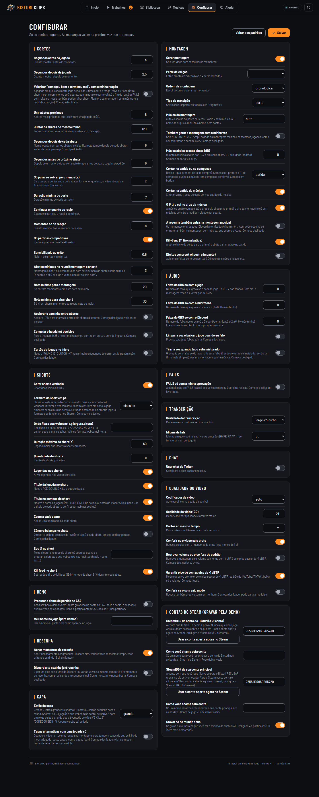
  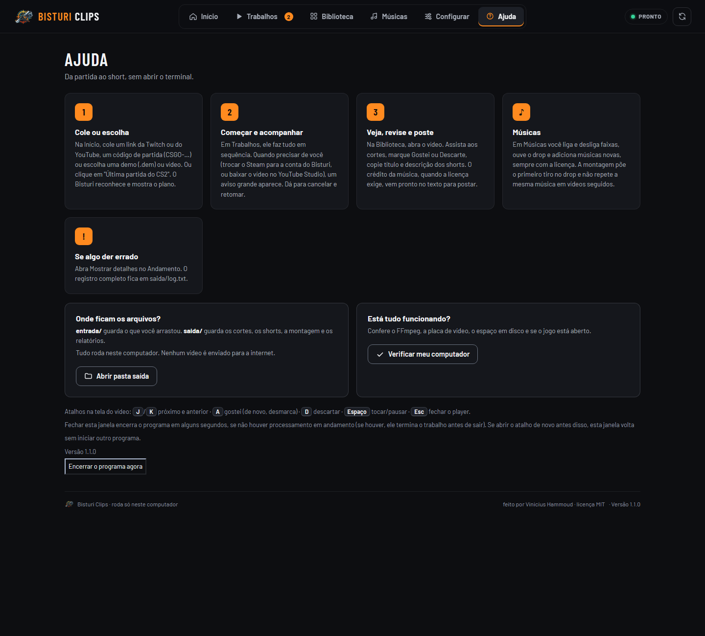<br>
  <em>Configurar (à esquerda) e Ajuda (à direita). Os números das contas na foto são de exemplo.</em>
</p>

<p align="center">
  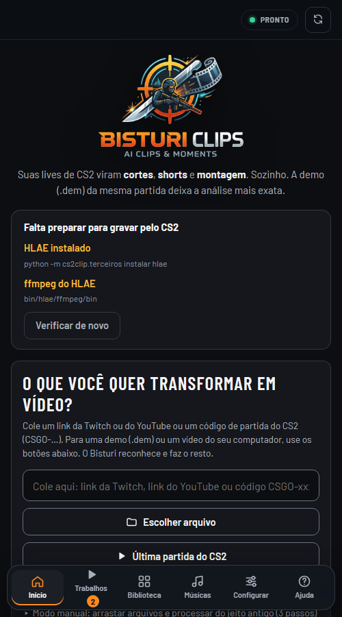<br>
  <em>A tela se ajusta a uma janela estreita. O programa roda só no seu computador.</em>
</p>

## De onde vem o vídeo: os quatro caminhos

**Nenhum destes caminhos precisa de uma segunda conta Steam.**

**1. Vídeo ou gravação do seu computador.** Clique em **Escolher arquivo** e escolha a gravação.

**2. VOD da Twitch.** Cole o link do VOD (`twitch.tv/videos/` e o número). Só funciona com VOD público do seu canal. Link de clipe não serve: o Bisturi precisa do VOD inteiro.

**3. Vídeo do YouTube.** Cole o link do vídeo. O Bisturi não baixa do YouTube por conta própria. Ele mostra o link **Abrir o vídeo no YouTube Studio** e você baixa pelo botão oficial (Opções, depois Baixar). O programa vigia a sua pasta Downloads, acha o arquivo e pergunta antes de seguir: clique em **É este arquivo** ou em **Não é este**.

**4. Demo baixada pelo CS2, junto do vídeo.** A demo (`.dem`) é o arquivo da partida que o próprio jogo guarda. Com ela, o placar, os rounds e os abates ficam exatos. Faça assim:

1. No CS2, abra **Assistir**, depois **Suas partidas**, e baixe a partida.
2. No Bisturi, abra **Configurar** e ligue **Procurar a demo da partida no CS2**. Clique em **Salvar**.
3. Processe o vídeo dessa partida por um dos três caminhos acima.

O programa acha a demo na pasta do CS2, confere pelos abates se é a mesma partida e descobre quem é você. Ele só lê e copia a demo. Se preferir, ponha o arquivo `.dem` na mesma pasta do vídeo e preencha "Meu nome no jogo (para demos)" em Configurar.

> **Atenção a uma caixinha do plano.** Quando você entrega um vídeo, um VOD ou um link do YouTube, o plano traz marcada a opção "Se o Bisturi achar a demo da partida, regravar os rounds bons em imagem limpa e juntar a minha voz". Essa regravação é da parte avançada e pede a conta do Bisturi. Ela só entra em cena quando o programa acha a demo, ou seja, no caminho 4. **Se você usa a demo e não preparou a parte avançada, desmarque a caixinha antes de clicar em Começar.** Se esquecer, o kit do seu vídeo sai do mesmo jeito. Só a etapa de regravar para e avisa o que falta.

Entregar **só a demo** na caixa da Início (pelo **Escolher arquivo**, pelo botão **Última partida do CS2** ou por um código `CSGO-`) é pedir a gravação pela demo. Isso é a parte avançada, logo abaixo.

## Avançado: gravar pela demo e baixar por código

Esta parte é **opcional e experimental**. O Bisturi abre o CS2, assiste à demo e regrava os seus melhores rounds em imagem limpa, sem webcam e sem overlay. Depois monta cortes, shorts e montagem com essa imagem. Ele também baixa a demo de uma partida a partir do código de partilha (`CSGO-` e cinco grupos de letras).

A gravação usa o HLAE e o download por código usa o boiler-writter. São programas de terceiros, de código aberto. O Bisturi baixa só a versão fixa de cada um e confere o SHA-256.

**As duas coisas exigem uma segunda conta Steam, a "conta do Bisturi", e uma regra no Firewall do Windows.**

O que o programa garante:

- **Nunca faz isso com a sua conta principal.** Se a principal estiver logada no Steam, ele recusa gravar e recusa baixar.
- **Nunca troca de conta sozinho e nunca guarda senha.** Ele pede, espera e confere. Quem troca de conta no Steam é você.
- **Nunca roda como administrador.** Se o programa foi aberto como administrador, ele recusa.
- **Tira uma "foto" dos arquivos do jogo e da conta principal** antes e depois de gravar. Se algo mudar, mostra ALERTA VERMELHO.
- **O console do jogo só aceita uma lista curta de comandos**, os que o gravador usa.

O que você precisa saber:

- O CS2 abre com `-insecure` (sem VAC) e com o HLAE, só para assistir à demo. **Não jogue online com a conta do Bisturi.**
- Uma atualização do CS2 pode quebrar a gravação. A gravação foi provada com o jogo de verdade. O download por código de partilha ainda não tem a mesma prova.

**Primeira vez, em 4 passos**

1. **Instale as ferramentas.** Rode o instalador de novo e marque a tarefa "Gravar pela demo: instalar o HLAE e o boiler (cerca de 130 MB no disco, cerca de 10 MB de download)".
2. **Crie a regra do Firewall**, uma vez só. O console do CS2 abre a porta 2121 para toda a rede, e a regra bloqueia o acesso a essa porta vindo de outros computadores. Abra o PowerShell **como administrador** e rode:
   ```powershell
   New-NetFirewallRule -DisplayName 'Bisturi bloqueia 2121' -Direction Inbound -Action Block -Protocol TCP -LocalPort 2121 -Profile Any
   ```
   Para desfazer: `Remove-NetFirewallRule -DisplayName 'Bisturi bloqueia 2121'`. O Firewall do Windows tem de estar ligado nos perfis Particular e Público. Enquanto a regra faltar, o cartão da Início traz o botão **Copiar o comando**.
3. **Diga quais são as contas.** Em **Configurar**, no grupo "Contas do Steam (gravar pela demo)", preencha a conta do Bisturi e a sua conta principal. O botão **Usar a conta aberta agora no Steam** preenche o número para você. Clique em **Salvar**. A conta principal serve só para o programa saber qual recusar.
4. **Feche o CS2 e o OBS** e abra o Bisturi pelo atalho, sem ser como administrador.

Quando tudo estiver certo, o cartão da Início mostra "Gravação pelo CS2: tudo pronto". Enquanto faltar algo, ele mostra "Falta preparar para gravar pelo CS2" e a lista do que falta.

**Para gravar:** na Início, clique em **Última partida do CS2**, escolha uma demo ou cole o código `CSGO-`. Clique em **Começar**. Em Trabalhos, o aviso "Troque o Steam agora" aparece na hora certa. Entre no Steam com a conta do Bisturi e o trabalho continua sozinho. **Quando terminar, volte para a sua conta principal.**

Para escolher cada passo, use **Trabalhos** e o link **Gravação manual (avançado)**. Lá o campo "Câmera em" põe a câmera em você ou em outro jogador da demo.

## Músicas

A **tela Músicas** mostra o catálogo de músicas livres. Você liga e desliga faixas, ouve o ponto alto com **Ouvir o drop** e adiciona músicas novas.

O programa só usa música com a licença escrita. Para adicionar uma faixa, escolha a licença na tela (CC0, Pixabay, NCS, StreamBeats, Biblioteca de Áudio do YouTube e outras). Arquivo solto na pasta, sem licença, nunca é usado. Quando a licença exige crédito, ele vem pronto no texto para postar.

De onde pegar música e o que cada licença pede: [`docs/MUSICAS_FONTES.md`](docs/MUSICAS_FONTES.md).

<p align="center">
  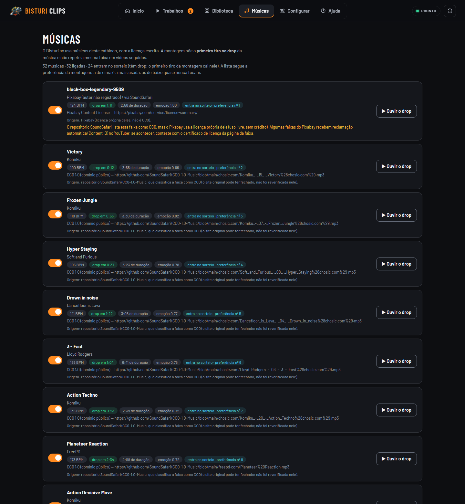<br>
  <em>A tela Músicas. Cada faixa mostra a licença e de onde veio.</em>
</p>

## Atualizar

1. Baixe o instalador da versão nova na aba **Releases**.
2. Rode por cima da instalação que você já tem. Não precisa desinstalar antes.

Os seus dados ficam: os vídeos, os kits, a configuração e o modelo de voz continuam na pasta de dados.

Se o Bisturi Clips estiver aberto, o instalador avisa e pede para você encerrar o programa. Ele não fecha o programa sozinho, para não interromper o seu trabalho. Espere o que estiver rodando terminar, abra **Ajuda**, clique em **Encerrar o programa agora** e depois em **Repetir** no instalador.

O que mudou em cada versão está no [`CHANGELOG.md`](CHANGELOG.md).

## Desinstalar

Abra as **Configurações** do Windows, depois **Aplicativos**, ache **Bisturi Clips** e clique em **Desinstalar**.

O desinstalador pergunta se você quer apagar também os dados que o programa criou. A resposta padrão é **Não**.

- Se você disser **Não**, os vídeos, os kits e a configuração ficam onde estão. Ele pergunta então se apaga só o modelo de voz, para liberar espaço.
- Se você disser **Sim**, ele apaga só o que é do programa: a configuração, os vídeos de entrada, os kits prontos, as gravações e o modelo de voz. Outras coisas que você guardou na mesma pasta ficam. Não dá para desfazer.

Dois detalhes:

- Se o programa estiver aberto, o desinstalador pede para você encerrar antes.
- Se a pasta de dados já tinha pastas suas com os nomes que o programa usa (como `saida` ou `entrada`) antes da instalação, o desinstalador não apaga nada dela e avisa.

Se você criou a regra do Firewall da parte avançada, ela não sai com o programa. O comando para removê-la está na parte avançada.

## Privacidade

**O programa roda no seu PC. A IA é local. Nada vai para a internet além do que você pede.**

- Os seus vídeos nunca são enviados para servidor nenhum. A análise, a transcrição da voz e a edição acontecem no seu computador.
- A tela do programa só responde ao seu próprio computador.
- Não existe login, conta nem cadastro.

A internet é usada só nestes momentos:

- Na instalação, para baixar as peças do programa.
- Para baixar o modelo de voz, se ele não veio na instalação.
- Quando você cola um link de VOD da Twitch, para baixar o VOD.
- Quando você cola um link do YouTube, o programa mostra o link do YouTube Studio. Quem baixa é você, pelo seu navegador.
- Na parte avançada, para baixar a demo pelo código de partilha.
- Se você ligar "Usar chat da Twitch" em Configurar, o programa baixa o chat público do VOD e pergunta à Twitch a hora da live. Isso só acontece com o chat ligado, e só o número do VOD sai do computador. O chat vem desligado.

## Perguntas frequentes

**O Windows mostrou uma tela azul dizendo que protegeu o computador. É vírus?**
Não. O aviso aparece porque o instalador ainda não tem assinatura digital. Clique em **Mais informações** e em **Executar assim mesmo**. Para conferir o arquivo, use o `SHA256SUMS.txt`, como explicado em [Instalar](#o-windows-protegeu-o-computador).

**O Windows bloqueou e não mostrou o botão "Executar assim mesmo". E agora?**
Alguns PCs com Windows 11 usam uma proteção mais rígida, que bloqueia programas sem assinatura. Esse caso não foi testado. Se acontecer com você, use a [instalação alternativa](#instalação-alternativa-zip-para-desenvolvedores) e conte para a gente numa Issue.

**Não tenho placa NVIDIA. Funciona?**
Funciona. O instalador avisa que não achou a placa e prepara o programa para usar só o processador. A parte de entender a voz fica mais lenta e usa o modelo de voz menor, de 0,5 GB. Os cortes também demoram mais para sair.

**O download do modelo de voz está demorando. É normal?**
É. O modelo tem 1,6 GB e o tempo depende da sua internet. Ele baixa uma vez só. Se a internet cair ou você cancelar, o que já veio fica guardado e o download continua de onde parou.

**Quanto espaço eu preciso de verdade?**
Cerca de 4 GB para o programa com placa NVIDIA, ou cerca de 2 GB sem. O que pesa depois são os vídeos: cada vídeo processado gera vários GB. A verificação do programa acusa erro com menos de 5 GB livres no disco e avisa quando há menos de 20 GB. Para liberar espaço, use **Apagar kit** nos vídeos que você não vai postar.

**Meu antivírus reclamou do instalador. O que eu faço?**
Na fase de testes, o Microsoft Defender não acusou nada. Outros antivírus não foram testados. O instalador baixa peças durante a instalação, e isso chama a atenção de alguns antivírus. Confira o arquivo com o `SHA256SUMS.txt`. Se a impressão digital bater e o antivírus ainda bloquear, abra uma Issue dizendo qual antivírus você usa.

**O programa mexe no meu jogo ou na minha conta Steam?**
Nos quatro caminhos normais, não. Ele só lê o vídeo e, se você quiser, a demo. Só a parte avançada abre o CS2, e sempre numa segunda conta, nunca na sua conta principal.

**A montagem saiu sem música. Por quê?**
Há dois motivos comuns. O primeiro: as músicas não foram baixadas. A tela Músicas avisa quando os arquivos faltam; rode o instalador de novo com a tarefa das músicas marcada. O segundo: a sua voz está misturada com o som do jogo na gravação. Grave o jogo e o microfone em faixas separadas no OBS e diga quais são em Configurar, no grupo Áudio. Ou ligue ali a opção "Tirar a voz quando tudo está misturado".

**Deu erro. Onde eu olho?**
Na Início, abra **Mostrar detalhes** no Andamento. Em **Ajuda**, clique em **Verificar meu computador**: ele confere o FFmpeg, a placa de vídeo, o espaço em disco e se o jogo está aberto.

## Créditos

Criado por **Vinicius Hammoud**.

O Bisturi Clips usa projetos de código aberto como FFmpeg, faster-whisper, OpenCV e RapidOCR. A lista completa, com a licença de cada peça, está em [`CREDITOS.md`](CREDITOS.md).

O código é distribuído sob a [licença MIT](LICENSE).

**Aviso sobre os ícones.** Os ícones do HUD que o programa usa como referência para ler o kill feed são recortes da tela do Counter-Strike 2, © Valve Corporation, e **não são cobertos pela licença MIT** deste projeto. Eles servem só para reconhecer o ícone na tela. O mesmo aviso está em `cs2clip/assets/icons/AVISO.txt`.

Counter-Strike 2 é marca da Valve Corporation. Este é um projeto independente, sem ligação com a Valve.

## Instalação alternativa (ZIP, para desenvolvedores)

Este caminho é para quem quer mexer no código ou não pode usar o instalador. Ele exige o **winget** (o "Instalador de Aplicativo" da Microsoft Store), que vem no Windows 11 e no Windows 10 atualizado.

1. Baixe o código em ZIP (botão verde **Code**, depois **Download ZIP**) e extraia a pasta inteira.
2. Dê dois cliques em **`instalar.bat`**. Ele instala o Python e o FFmpeg pelo winget, se faltarem, depois os pacotes e o modelo de voz. Na primeira vez demora, porque baixa cerca de 3 GB.
3. No fim ele cria o atalho **Bisturi Clips** na Área de Trabalho.

Diferenças para o instalador:

- **Avisos do Windows.** Se aparecer "Abrir Arquivo - Aviso de Segurança", clique em **Executar**. Se aparecer a tela azul do SmartScreen, clique em **Mais informações** e em **Executar assim mesmo**.
- **Os dados ficam dentro da pasta do programa** (pastas `entrada` e `saida`), e não numa pasta de dados separada.
- **As músicas não vêm no ZIP.** Sem elas a montagem sai sem música. Para baixar as faixas livres do catálogo, rode `.venv\Scripts\python.exe tools\baixar_musicas_cc0.py`. Para adicionar as suas, sempre com a licença, veja [`musicas/COMO_ADICIONAR_MUSICAS.md`](musicas/COMO_ADICIONAR_MUSICAS.md).
- **Gravar pela demo.** Para ver o que falta, sem abrir nada: `gravar_pela_demo.bat --demo auto --so-checar`.

As opções nascem do arquivo [`config.exemplo.toml`](config.exemplo.toml). A tela Configurar mexe nelas por você.

## Como relatar um problema

Abra uma **Issue** neste repositório e escolha o modelo **Problema** ou **Ideia**. O modelo já pede o que ajuda a resolver: a versão do programa (está no rodapé da tela e na Ajuda), o Windows, a placa de vídeo e os passos para repetir.

Uma boa ajuda é colar o resultado de **Ajuda**, botão **Verificar meu computador**.

Antes de enviar:

- **Não cole o seu `config.toml`.**
- **Não cole links privados**, tokens, números de conta Steam nem caminhos com o seu nome de usuário.
- Apague das imagens o que for pessoal.

Achou uma falha de segurança? Não use Issue pública. Siga o [`SECURITY.md`](SECURITY.md).

Quer contribuir? Leia o [`CONTRIBUTING.md`](CONTRIBUTING.md).
