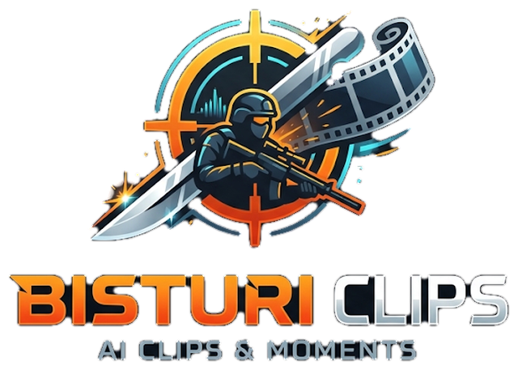
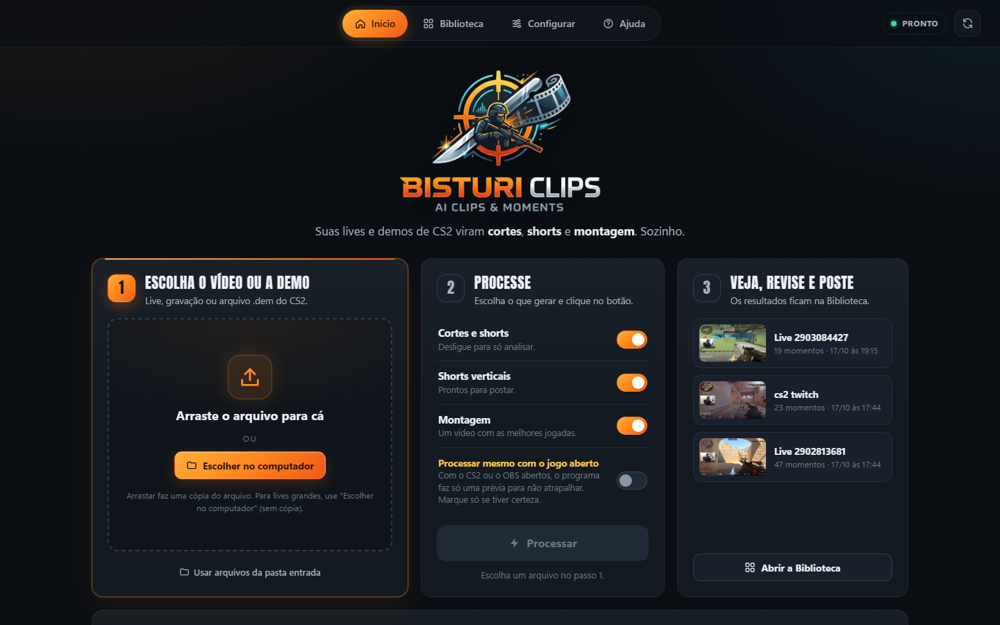
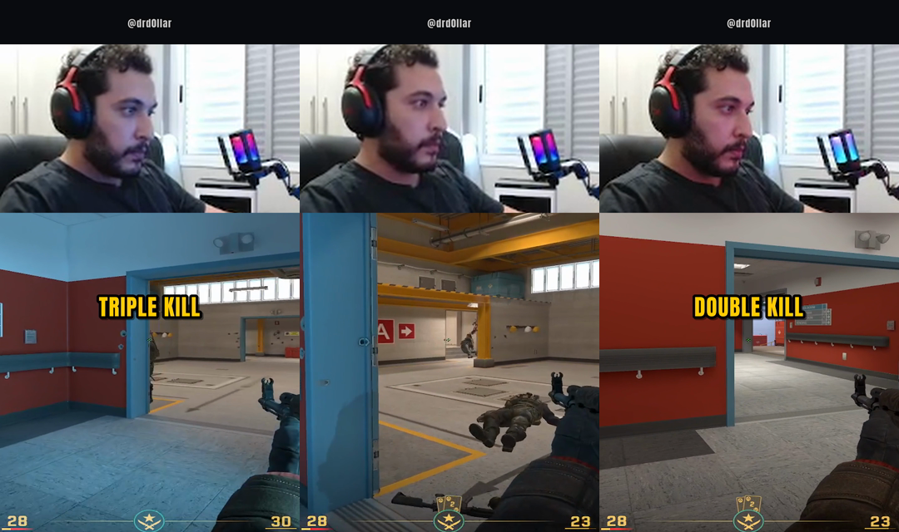
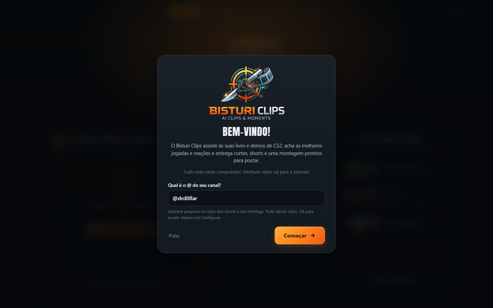
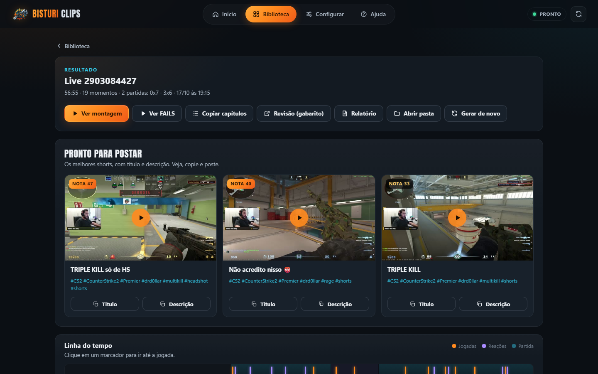
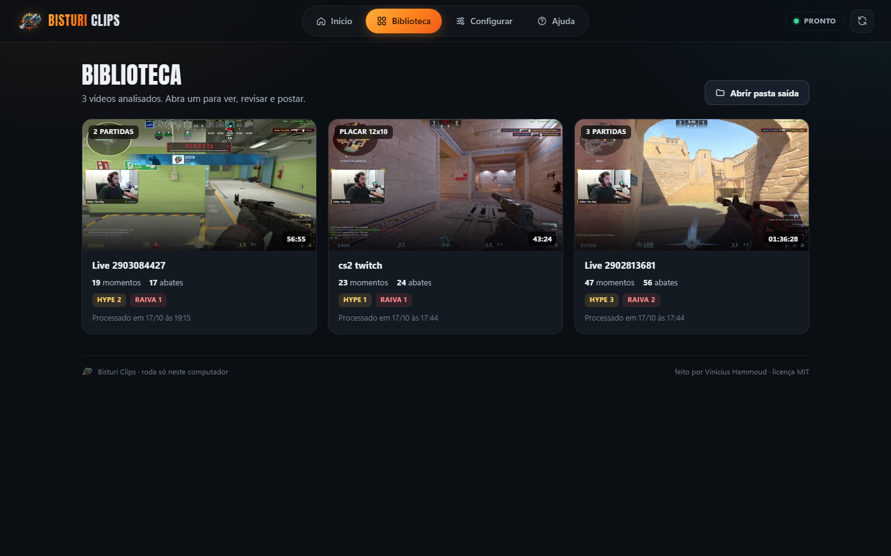
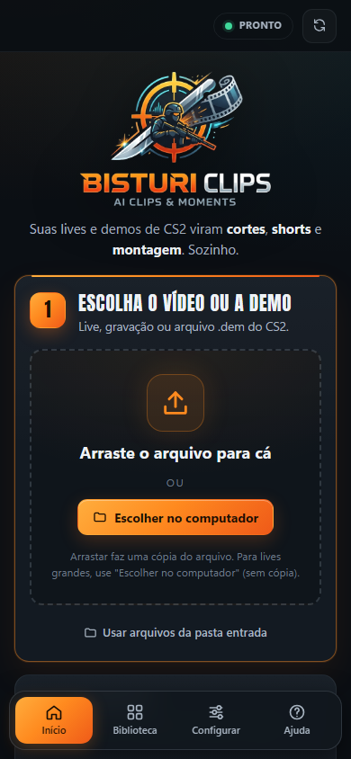
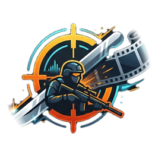

  

<h3 align="center">Sua live de CS2 vira cortes, shorts e montagem. Sozinho.</h3>

  
  
  
  

  <a href="#-instalar">Instalar</a> ·
  <a href="#-como-usar">Como usar</a> ·
  <a href="#-o-que-sai-pronto">O que sai pronto</a> ·
  <a href="#-perguntas-frequentes">Perguntas</a>

---

Você joga, faz live ou grava a partida. O **Bisturi Clips** assiste ao vídeo inteiro, acha as suas **jogadas** (do 1 tiro ao ACE) e as suas **reações** (raiva, hype, risada), e entrega tudo **editado e pronto para postar** no TikTok, Reels e YouTube Shorts.

Sem enviar nada para a internet, sem assinatura, sem marca d'água de terceiros.

  

## ✂️ O que ele faz

- **Lê o kill feed do jogo** e acha cada abate seu, com headshot, através da fumaça, double, triple, quadra e ACE.
- **Junta o round inteiro num vídeo só.** Matou 1, esperou, matou mais 3? Vira uma jogada só, com o tempo parado cortado.
- **Ouve a sua voz.** Grito de comemoração, raiva depois de morrer, risada e até o comando falado **"clipa isso"**.
- **Dá uma nota de 0 a 99** para cada momento e escolhe os melhores.
- **Monta shorts verticais profissionais.** Webcam em cima, jogo embaixo com a mira no centro, legenda animada, selo da jogada (TRIPLE KILL, ACE...), gancho nos 2 primeiros segundos e o seu @ (o @ aparece no topo quando a webcam é detectada).
- **Faz duas versões de cada short**: uma limpa e outra com efeitos (tremida no abate e replay em câmera lenta).
- **Separa os FAILS** (as mortes engraçadas ou de raiva) numa compilação própria.
- **Escreve títulos e hashtags** para cada short. É só copiar e postar.

  

## 💻 Do que você precisa

| | |
|---|---|
| **Sistema** | Windows 10 ou 11, com o **winget** (App Installer). Ele vem no Windows 11 e no Windows 10 atualizado; se faltar, instale o "Instalador de Aplicativo" pela Microsoft Store. |
| **Placa de vídeo** | NVIDIA recomendada (GTX 1650 ou melhor). Sem ela também funciona: o instalador escolhe um modelo de voz menor e mais rápido, e a análise de uma live longa leva bem mais tempo. |
| **Espaço livre** | ~10 GB para o programa, mais o espaço dos seus vídeos |
| **Vídeo** | gravação ou VOD da partida com o **kill feed visível** (OBS, Twitch, ShadowPlay, Medal...). Webcam é opcional. |
| **Idioma do jogo** | português, inglês ou espanhol |

## 📥 Instalar

1. Clique no botão verde **Code → Download ZIP** aqui em cima e extraia a pasta onde quiser (ex.: `Documentos\Bisturi Clips`).
2. Dê dois cliques em **`instalar.bat`**. Ele instala tudo sozinho: Python, FFmpeg, os pacotes e o modelo de voz. Na primeira vez demora, porque baixa uns 3 GB.
3. No fim, aparece o atalho **Bisturi Clips** na sua Área de Trabalho. Pronto.

> O Windows pode mostrar um aviso na primeira vez. Se aparecer **"Abrir Arquivo - Aviso de Segurança"** (comum com o `.bat` baixado em ZIP), clique em **Executar**. Se aparecer a tela azul **"O Windows protegeu o computador"** (SmartScreen, só em alguns casos), clique em **Mais informações → Executar assim mesmo**. O programa é de código aberto: tudo o que ele faz está aqui no GitHub.

## 🎮 Como usar

**1. Abra o programa** pelo atalho. Abre só a janela do Bisturi Clips, sem tela preta de comandos; para sair, é só fechar a janela (se houver um processamento em andamento, ele termina o trabalho antes de encerrar). Na primeira vez ele pergunta o @ do seu canal (vai nas hashtags e, quando a webcam é detectada, no topo dos shorts).

  

**2. Escolha o vídeo** (ou arraste para a janela) e clique em **Processar**. A primeira análise de uma live longa leva alguns minutos (mais sem placa NVIDIA); depois o resultado fica guardado.

**3. Veja, revise e poste.** Os resultados ficam na **Biblioteca**. Em cada vídeo você tem os shorts prontos com título e descrição, a montagem, os FAILS, a linha do tempo e todos os cortes.

  

  
  

> **Não atrapalha o seu jogo.** Com o CS2 ou o OBS abertos, o programa só faz uma prévia leve e deixa o trabalho pesado para quando você fechar o jogo.

## 📦 O que sai pronto

Tudo fica na pasta `saida\<nome do vídeo>\` (o botão **Abrir pasta** leva até ela):

| Arquivo | O que é |
|---|---|
| `shorts\*_vertical.mp4` | os melhores momentos em 9:16, prontos para TikTok, Reels e Shorts |
| `shorts\*_vertical_efeitos.mp4` | a mesma jogada com tremida e replay em câmera lenta |
| `publicar.txt` | 3 opções de título, descrição e hashtags para cada short |
| `MONTAGEM_*.mp4` | um vídeo com as melhores jogadas, para o YouTube |
| `FAILS_*.mp4` | a compilação das mortes engraçadas ou de raiva |
| `cortes\*.mp4` | cada jogada e reação em 16:9, separadas |
| `capitulos_youtube.txt` | capítulos para colar na descrição da live no YouTube |
| `marcadores_*.edl` | os cortes marcados para abrir no DaVinci Resolve ou no Premiere |

## 🧠 Como ele escolhe

| Sinal | O que o programa olha |
|---|---|
| **Abates** | as linhas do kill feed com borda vermelha (as suas), os ícones de headshot e fumaça, e o tempo entre os abates |
| **Rounds** | o banner de fim de round (vitória ou derrota) e o painel "matou você", para saber o round de cada jogada e onde ela termina |
| **Voz** | o quanto a sua voz sobe acima do seu tom normal, sem confundir com tiro |
| **Falas** | o que você fala (transcrito no seu PC): comemoração, raiva, risada, "clipa isso". Callout ("meio, meio", "B") não conta como emoção. |
| **Chat da Twitch** | picos de mensagens e de KEKW/POG, quando o vídeo é um VOD da Twitch |

Mais pontos para multi-kill, headshot, match point, pistol e reação forte. Os momentos com nota alta viram short; os médios entram na montagem.

## ❓ Perguntas frequentes

**Ele mexe no meu jogo ou na minha conta?**
Não. Ele só lê o arquivo de vídeo (e a demo `.dem`, se você quiser). Não toca no CS2, na Steam nem na sua config.

**Meus vídeos vão para algum servidor?**
Não. Tudo roda no seu computador. A internet só é usada na instalação e, se o vídeo for VOD da Twitch, para baixar o chat público.

**Funciona com 4:3 esticado, 4:3 com barras pretas e 16:9?**
Sim. O 4:3 esticado foi o mais testado; os outros foram testados com vídeos convertidos. Se algo sair estranho no seu formato, abra uma *issue* com um trecho do vídeo.

**As reações funcionam em outro idioma?**
Por enquanto a voz (raiva, hype, risada) entende **português**. Abates, rounds e mortes funcionam com o jogo em português, inglês ou espanhol.

**O instalador disse que o winget não existe. E agora?**
Instale o Python 3.12 em python.org (marque *Add Python to PATH*). Baixe o FFmpeg em ffmpeg.org (build do gyan.dev) e copie `ffmpeg.exe` e `ffprobe.exe` para a pasta `bin\` do programa. Depois dê dois cliques no `instalar.bat` de novo.

**Posso usar a demo da partida?**
Pode, e fica bem melhor. Só a `.dem`: informe o seu nick e o programa lê abates, clutch, ACE e o placar direto dela.
Com o **vídeo da mesma partida**, ponha a `.dem` na mesma pasta dele e informe o seu nick (`[demo] jogador` no `config.toml`, ou `--jogador "nick"` na linha de comando): o programa liga os dois sozinho e usa os fatos exatos da demo no vídeo (placar e rounds certos, headshot, parede, noscope, clutch). Demo de outra partida é ignorada.

**Dá para mudar o visual dos shorts?**
Sim, na tela **Configurar**: o seu @, a quantidade de shorts, a legenda, o zoom e outras opções.

## 🙌 Créditos

Criado por **Vinicius Hammoud** — [twitch.tv/drd0llar](https://twitch.tv/drd0llar).

O Bisturi Clips usa projetos de código aberto incríveis, como FFmpeg, faster-whisper, OpenCV e RapidOCR. A lista completa está em [CREDITOS.md](CREDITOS.md).

Counter-Strike 2 é marca da Valve Corporation. Este é um projeto independente, sem ligação com a Valve.

Distribuído sob a [licença MIT](LICENSE): use, modifique e compartilhe à vontade, mantendo o crédito.

  

